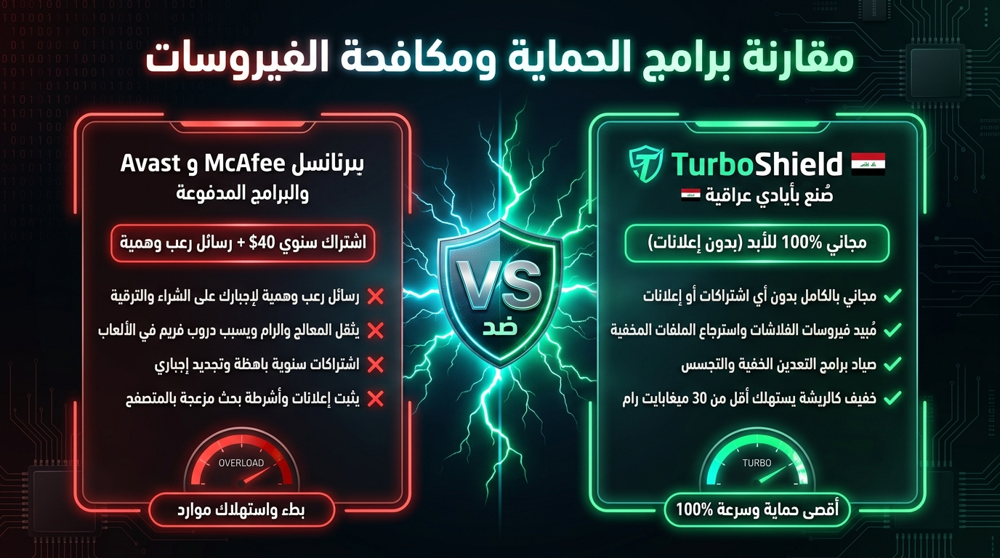

# 🛡️ TurboShield — Next-Gen Windows Antivirus & Threat Hunter

> Ultra-fast, lightweight, 100% ad-free Windows cybersecurity shield, malware scanner, and USB virus doctor. Designed as a clean-room, zero-nag alternative to bloated commercial antivirus software.

---

## 🚀 Key Features

* **🔍 Smart Threat & Malware Scanner**:
  * **Heuristic Engine**: Detects sneaky double-extension trojans (e.g. `document.pdf.exe`), malicious scripts (`.vbs`, `.js`, `.scr`, `.hta`), and ransomware droppers in temporary execution directories.
  * **Quick Scan & Custom Folder Scan**: Scans memory, startup zones, AppData, and user folders with real-time file counters and SHA-256 calculation.
  * **Safe Quarantine**: Isolate and neutralize threats without corrupting Windows system files.

* **💾 USB Shortcut Virus Doctor (طبيب الفلاشات)**:
  * **1-Click Disinfection**: Automatically kills malicious shortcut worms on removable USB drives.
  * **Hidden Files Recovery**: Restores and unhides all legitimate files and folders locked by malware.
  * **Autorun Shield Immunity**: Locks the drive's autorun vectors against future reinfection.

* **🕵️ Live Process & Crypto-Miner Hunter**:
  * **Cryptominer Detection**: Audits running processes for hidden miners (XMRig, cpuminer, etc.).
  * **Masquerading Binaries**: Catches fake system services (e.g. `svchost.exe` running from Temp or AppData).
  * **1-Click Kill**: Immediately halts rogue processes and isolates their binaries.

* **🌐 Network & HOSTS Integrity Shield**:
  * **Browser Hijack Detection**: Verifies that malware has not tampered with your Windows `hosts` file to intercept banking or search traffic.
  * **1-Click Restore**: Replaces tampered hosts files with clean Microsoft defaults.
  * **DNS Cache Flush**: Clears poisoned DNS resolver caches instantly.

* **🎮 Gamer Friendly & Lightweight**:
  * Consumes under **30 MB RAM** (compared to 400MB+ for McAfee / Norton). Zero FPS drops during gaming sessions.

* **🌐 Bilingual Support**:
  * Seamlessly toggle between **العربية 🇮🇶** and **English 🌐**.

---

## 📥 Installation

1. Download the latest installer: [**TurboShield Setup 1.0.0.exe**](https://github.com/mohammedtawad88-hue/TurboShield/releases/download/v1.0.0/TurboShield.Setup.1.0.0.exe).
2. Run the installer wizard.
3. Launch TurboShield and enjoy 100% free, lifetime protection!

---

## 📄 License
MIT License. Free for personal and commercial use.
